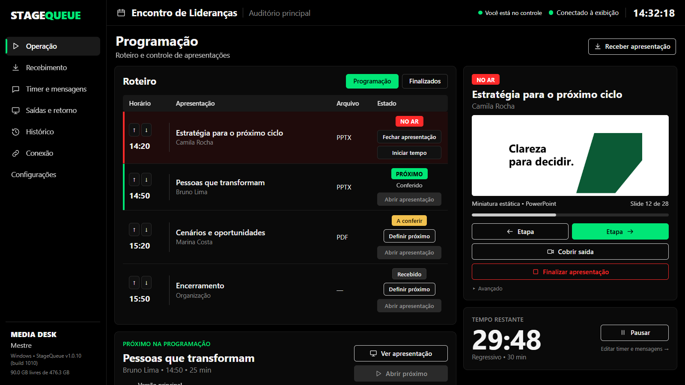
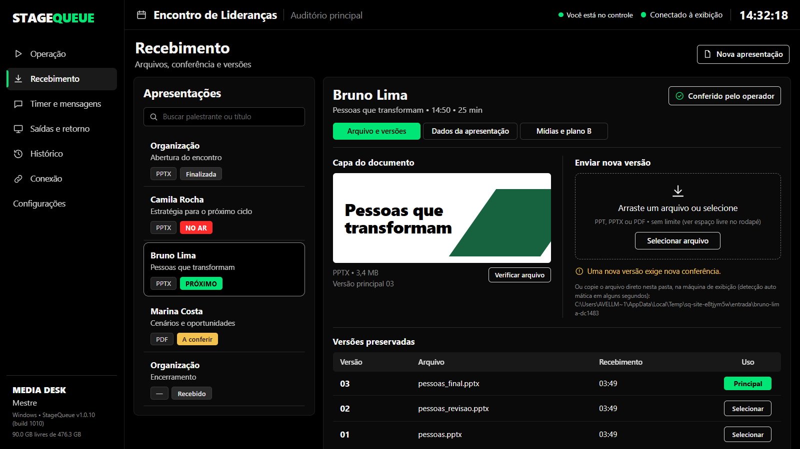
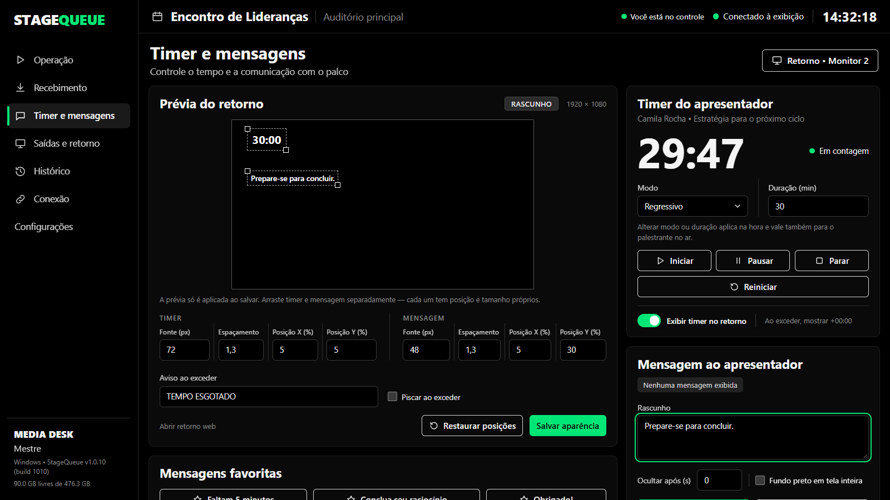
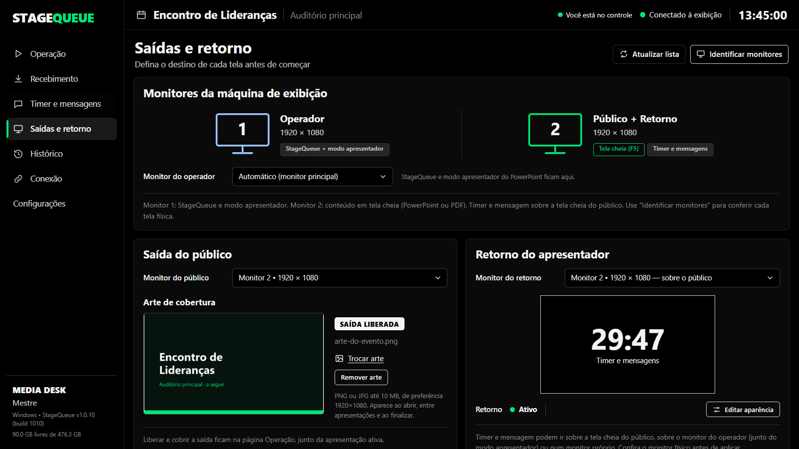

# StageQueue

Fila de apresentações para eventos ao vivo. O **Mestre** comanda de outro computador e a máquina
de **Exibição** só transmite: recebe o arquivo, coloca no ar em tela cheia e já prepara o próximo.
O público nunca vê área de trabalho, janela de programa ou arquivo errado. Funciona com
**PowerPoint**, **Adobe Acrobat/Reader**, **PDF-to-PPT** e links do **Canva** e **Google Slides**.



Site oficial, novidades e verificação de versão: **https://stagequeue.pages.dev**

> Este repositório guarda só os **downloads** (espelho do site). O código-fonte não é público.

## O que ele faz

- **Três papéis, três máquinas.** O Mestre controla, a Exibição transmite e o Colaborador recebe
  e confere os arquivos dos palestrantes. A conexão é pela rede local, com código de pareamento.
- **Tela do evento entre apresentações.** A arte do evento em PNG ou JPG, ou um texto de espera,
  cobre a saída ao abrir, ao trocar e ao finalizar.
- **Sequência automática.** Ao finalizar, a saída é coberta com a tela do evento, o aplicativo é
  fechado e o próximo conferido já fica pronto atrás da cobertura. Só vai ao público quando o
  Mestre clicar em **Colocar NO AR**.
- **Controle de verdade dos aplicativos.** Abre, coloca em tela cheia no monitor do público, avança
  e volta etapas e fecha, tudo pelo Mestre. Se o programa cair, o StageQueue avisa na hora.
- **Miniatura do que está no ar.** O painel mostra o slide ou a página atual.
- **Timer e mensagens para o palestrante** no monitor de retorno, com posição, fonte e aviso de
  tempo esgotado.
- **Conferência e plano B.** Versões de cada arquivo são preservadas, cada palestrante pode ter uma
  apresentação alternativa, e há histórico e relatório de execuções.

## Como é a operação

1. O Colaborador ou o Mestre recebe o arquivo e marca como **conferido**.
2. **Abrir próximo:** o arquivo abre atrás da cobertura, com a tela do evento no público.
3. **Colocar NO AR:** a apresentação aparece em tela cheia. Etapas avançam e voltam.
4. **Finalizar:** a saída volta para a tela do evento, o aplicativo é fechado e o próximo conferido
   já fica preparado. Volte ao passo 3.

## Telas

| | |
| :---: | :---: |
|  |  |
| **Recebimento:** arquivos recebidos, conferência, versões e plano B | **Timer e mensagens:** prévia do retorno do palestrante |



**Saídas e retorno:** cada monitor recebe uma função (operador, público e retorno), e aqui também se
escolhe a arte de cobertura do evento.

## Baixar

Abra as [releases](../../releases) e escolha um dos arquivos:

| Arquivo | Para quem |
| :--- | :--- |
| `StageQueue-Setup-...exe` | **Recomendado.** Instala para o seu usuário, sem pedir administrador, com atalho e desinstalação pelo Windows. |
| `StageQueue-...exe` | Executável único, sem instalação. Abre um pouco mais devagar. |
| `StageQueue-Portable-...zip` | Versão portátil: extraia e rode de uma pasta ou pendrive. |

São **os mesmos arquivos** do site, com o mesmo SHA-256, que aparece na descrição de cada release.
Use o GitHub quando o download pelo site estiver lento ou bloqueado na sua rede.

**Use a mesma versão em todas as máquinas do evento.** O aplicativo avisa quando sai uma versão
nova. Ele só consulta o site oficial: nada é baixado nem instalado sozinho.

Versões marcadas como **pré-lançamento** são de bancada: passaram nos testes automáticos e nos
ensaios com os aplicativos, mas ainda aguardam a validação manual completa no evento.

## Requisitos

- Windows 10 ou 11, 64 bits
- Microsoft Edge WebView2 (já vem no Windows 11 e na maioria dos Windows 10 atualizados)
- Na máquina de Exibição: PowerPoint, Adobe Acrobat/Reader e/ou PDF-to-PPT, conforme os arquivos do evento

## Conferir o arquivo baixado

No PowerShell, na pasta do download:

```powershell
Get-FileHash .\StageQueue-Setup-v1.0.10-build1010.exe
```

O resultado tem que ser igual ao SHA-256 publicado na release e no site.

## Assinatura e antivírus

Os pacotes são assinados por **Mizin Produções Audiovisuais** com certificado **autoassinado**.
Isso não dá confiança pública automática no Windows: o SmartScreen pode avisar na primeira
execução. **Não desative o antivírus.** Se houver detecção de ameaça, interrompa a execução e
informe o diagnóstico.

## Contato

Mizin Produções Audiovisuais · https://stagequeue.pages.dev

Software proprietário. Todos os direitos reservados.
